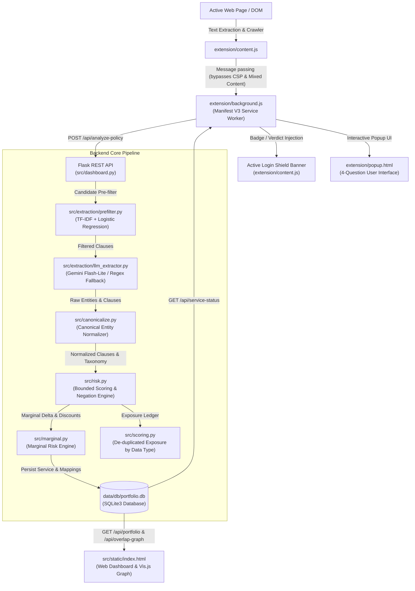

# ClauseGuard — Comprehensive Technical Viva Notes & Architectural Guide

**Repository:** `clauseguarddemowork`  
**Target Review:** Comprehensive Technical Defense / Viva Examination  
**System Architecture:** Flask Backend + Manifest V3 Chrome Extension + SQLite + Vis.js Dashboard  
**Status of Test Suite:** 141 Passed / 0 Failed (100% test pass rate across 22 test modules)

---

## 1. System Architecture & End-to-End Workflow

ClauseGuard is an automated privacy risk assessment and exposure monitoring system designed to inspect terms of service/privacy policies, extract operative data practices, canonicalize entities, and calculate bounded, explainable portfolio-level privacy risks.



### End-to-End Data Pipeline Execution Steps:
1. **Detection & Link Discovery (`extension/content.js`)**:
   - The user visits a website or an authentication page.
   - The content script inspects page title, URL path, headings, and DOM anchor tags (`<a>`) using multi-word privacy phrases (`['privacy policy', 'privacy notice', 'privacy statement', 'data protection policy']`).
   - Foreign third-party OAuth/captcha policies (e.g. Google reCAPTCHA, Cloudflare Turnstile, hCaptcha) are filtered out via apex domain matching (`getApexDomain`), ensuring only the primary service's policy is targeted.
2. **CSP & Mixed-Content Bypass (`extension/background.js`)**:
   - Web pages loaded over HTTPS block requests to localhost (`http://127.0.0.1:5000`) due to Mixed Content and Content Security Policies (CSP).
   - `content.js` dispatches an internal message (`chrome.runtime.sendMessage`) to the Manifest V3 background service worker, which executes the fetch from `chrome-extension://` origin without CSP blocking.
3. **Extraction & Canonicalization (`src/extraction/` & `src/canonicalize.py`)**:
   - `prefilter.py` filters raw sentences using TF-IDF and Logistic Regression to discard non-privacy boilerplate.
   - `llm_extractor.py` queries Gemini Flash-Lite (or uses the grounded regex/heuristic mock engine if offline/keyless) to extract clauses, severity scores (1–5), specificity scores (1–5), and raw entity mentions.
   - `canonicalize.py` maps raw entity phrases (e.g., `"user location"`, `"gps"`, `"coordinates"`) to authoritative canonical entities (`"Location"`).
4. **Scoring, Linguistic Negation, & Calibration (`src/risk.py`)**:
   - Clause risk is bounded to 0–100.
   - Linguistic negation and contrastive shifting are applied (e.g., protecting against treating "We do not sell your personal data" as an affirmative risk).
   - Raw policy risk is computed as the mean of the top $K=5$ most severe clauses.
   - Raw scores are calibrated against the reference distribution of 16 empirical services (`reference_services.json`) so typical consumer platforms land near score 50.
5. **Portfolio & Marginal Delta Evaluation (`src/marginal.py` & `src/scoring.py`)**:
   - When added to the portfolio, `MarginalRiskEngine` calculates new vs. overlapping entities against the baseline portfolio.
   - An overlap discount weight ($W_{\text{overlap}} = 0.5$) is applied: overlapping data types are discounted by up to 50%, reflecting remaining breach exposure and attack surface growth.
   - The Exposure Ledger (`get_exposure_by_data_type`) compiles cumulative worst-case disclosures per data type without double-counting shared permissions.
6. **Persistence & Presentation (`src/db.py` & UI)**:
   - Normalized services, clauses, canonical entities, and join mappings are committed to `data/db/portfolio.db`.
   - The web dashboard presents the Exposure Ledger, interactive Vis.js bipartite network graph, and pairwise comparator.
   - In-browser, the Active Login Shield displays an inline risk banner directly above password fields on login forms.

---

## 2. Core Modules, Important Functions, & Dependencies

### Python Backend Stack (`clauseenv`)
- **Flask 3.1.0**: Lightweight REST API, CORS headers, route dispatching.
- **scikit-learn 1.6.1 & numpy 2.2.3**: TF-IDF vectorization, logistic regression pre-filtering.
- **sqlite3**: Zero-config relational database with foreign key constraints.
- **python-dotenv 1.2.2**: Secure environment variable loading (`.env`).
- **urllib.request / urllib.error**: Direct HTTP calls to Google Generative Language API without heavy SDK overhead.
- **pytest 9.1.1**: Test runner enforcing 141 regression and contract invariants.

### Key Source Files & Functions

| File | Core Classes / Functions | Primary Responsibility |
|---|---|---|
| [`src/risk.py`](file:///c:/Users/janah/OneDrive/Documents/Desktop/clauseguarddemowork/src/risk.py) | `clause_risk_0_100()`, `policy_risk_score()`, `calibrate_score()`, `inspect_policy_statement()`, `is_negated_claim()`, `get_presentation_verdict()`, `coverage_report()`, `segment_policy_document()` | Mathematical risk scoring (0–100), continuous piecewise calibration, linguistic negation parser, document chunking, thin evidence guard. |
| [`src/scoring.py`](file:///c:/Users/janah/OneDrive/Documents/Desktop/clauseguarddemowork/src/scoring.py) | `ScoringEngine`, `calculate_clause_score()`, `get_portfolio_data()`, `get_exposure_by_data_type()` | Portfolio baseline scoring, de-duplicated cumulative exposure ledger where each canonical data type is scored once at worst-case severity. |
| [`src/marginal.py`](file:///c:/Users/janah/OneDrive/Documents/Desktop/clauseguarddemowork/src/marginal.py) | `MarginalRiskEngine`, `calculate_marginal_risk()` | Computes incremental marginal risk delta ($\Delta$) with a 50% discount for overlapping entity permissions; simulates portfolio delta in memory. |
| [`src/canonicalize.py`](file:///c:/Users/janah/OneDrive/Documents/Desktop/clauseguarddemowork/src/canonicalize.py) | `EntityCanonicalizer`, `canonicalize()`, `extract_and_canonicalize()` | Standardizes hundreds of raw entity variants (e.g. "gps coordinates", "ip") into 17 canonical entities; maps to SQLite canonical dictionary. |
| [`src/extraction/prefilter.py`](file:///c:/Users/janah/OneDrive/Documents/Desktop/clauseguarddemowork/src/extraction/prefilter.py) | `PrivacyPrefilter`, `train()`, `filter_candidates()` | Lightweight binary classifier (TF-IDF + Logistic Regression) discarding non-privacy boilerplate before LLM invocation. |
| [`src/extraction/llm_extractor.py`](file:///c:/Users/janah/OneDrive/Documents/Desktop/clauseguarddemowork/src/extraction/llm_extractor.py) | `LLMExtractor`, `extract()`, `_call_real_llm()`, `_call_mock_llm()` | LLM semantic extractor querying Gemini Flash-Lite with structured JSON schema; features deterministic regex-based offline mock fallback. |
| [`src/dashboard.py`](file:///c:/Users/janah/OneDrive/Documents/Desktop/clauseguarddemowork/src/dashboard.py) | Flask App, `/api/analyze-policy`, `/api/save-service`, `/api/portfolio`, `/api/portfolio/reset`, `/api/compare`, `/api/compare-services`, `/api/overlap-graph`, `/api/service-status` | REST controller exposing analysis, persistence, single-service comparison, pairwise marginal comparison, and portfolio lifecycle management. |
| [`src/db.py`](file:///c:/Users/janah/OneDrive/Documents/Desktop/clauseguarddemowork/src/db.py) | `init_db()`, `reset_db()` | SQLite schema initialization with foreign keys enabled; safe table truncation across Windows file-locking environments. |
| [`extension/background.js`](file:///c:/Users/janah/OneDrive/Documents/Desktop/clauseguarddemowork/extension/background.js) | `chrome.runtime.onMessage` listener | Background service worker proxying API fetch requests to eliminate CORS, CSP, and HTTPS-to-HTTP mixed content blocks. |
| [`extension/content.js`](file:///c:/Users/janah/OneDrive/Documents/Desktop/clauseguarddemowork/extension/content.js) | `extractPageText()`, `findPrivacyPolicyLink()`, `isThirdPartyAuthOrWidget()`, `initActiveLoginShield()`, `injectShieldUI()` | DOM reader, document truncation (250k char ceiling), cross-domain third-party auth filter, Active Login Shield DOM banner injection. |
| [`extension/popup.js`](file:///c:/Users/janah/OneDrive/Documents/Desktop/clauseguarddemowork/extension/popup.js) | `renderSiteCard()`, `render4Questions()`, `renderCompareSection()` | Popup UI rendering the 4 non-technical user questions, risk bands, portfolio add actions, and live comparison against saved portfolio. |

---

## 3. Mathematical Formulas & Scoring Mechanics

### 1. Clause Risk Formula
For any extracted clause $c$ with severity $\text{sev} \in [1.0, 5.0]$ and specificity $\text{spec} \in [1.0, 5.0]$:
$$\text{Clause Risk}(c) = 100 \times \left(\frac{\text{Severity}(c)}{5.0}\right) \times \left(\frac{\text{Specificity}(c)}{5.0}\right)$$
- Minimum score: $100 \times (1/5) \times (1/5) = 4.0$
- Maximum score: $100 \times (5/5) \times (5/5) = 100.0$
- Missing or invalid dimensions strictly evaluate to $0.0$.

### 2. Policy-Level Risk (Top-K Aggregation)
Instead of a sum (which penalizes long policies simply for having more clauses), ClauseGuard uses a Top-K mean aggregation ($K = 5$):
$$\text{Raw Policy Score} = \frac{1}{\min(N, K)} \sum_{i=1}^{\min(N, K)} \text{Clause Risk}_{(i)}$$
where $\text{Clause Risk}_{(i)}$ represents the $i$-th clause ordered descending by risk.  
*Key Property:* Adding 100 pages of mild privacy boilerplate does not dilute or artificially increase the score of a company tracking biometric or location data.

### 3. Continuous Piecewise Linear Calibration
Because standard consumer web apps routinely trigger high-severity clauses (cookies, analytics, advertising), uncalibrated Top-5 raw scores cluster heavily between 75 and 90, creating alarm fatigue. ClauseGuard calibrates raw scores using the empirical median $M_{\text{ref}} = 78.0$ of 16 reference platforms (`data/calibration/reference_services.json`):
$$\text{Calibrated Score}(r) = \begin{cases} 
50.0 \times \left(\frac{r}{M_{\text{ref}}}\right) & \text{if } 0 \le r \le M_{\text{ref}} \\
50.0 + 50.0 \times \left(\frac{r - M_{\text{ref}}}{100.0 - M_{\text{ref}}}\right) & \text{if } M_{\text{ref}} < r \le 100.0 
\end{cases}$$
*Effect:* Monotonically maps $0 \to 0$, $M_{\text{ref}} (78.0) \to 50.0$, and $100 \to 100$. Everyday platforms land in the `typical` range ($40–60$), allowing genuinely dangerous or privacy-respecting apps to stand out.

### 4. Risk Bands (Machine-Readable vs. Presentation)
| Band Key | Score Range | Presentation Label | Color | Guidance / Description |
|---|---|---|---|---|
| `very_low` | $0.0 - 19.99$ | Lower Risk | Green | Strict confidentiality; no commercial tracking. |
| `low` | $20.0 - 39.99$ | Lower Risk | Green | Limited collection essential for service operation. |
| `typical` | $40.0 - 59.99$ | Moderate Risk | Amber | Standard web/mobile commercial data practices. |
| `high` | $60.0 - 79.99$ | Elevated Risk | Red | Extensive tracking, behavioral profiling, partner sharing. |
| `very_high` | $80.0 - 100.0$ | Elevated Risk | Red | Explicit data sale, unbounded third-party monetization. |

*Thin Evidence Guard:* If analysed text is $< 300$ characters or clauses found $< 2$, the system refuses to issue a "Low Risk" or "Safe" verdict. It returns `verdict: "Insufficient Evidence"` and `label: "Unable to assess"`.

### 5. De-duplicated Portfolio Exposure Ledger
In `ScoringEngine.get_exposure_by_data_type()`:
- Each canonical entity $e \in \mathcal{E}$ is scored once at the worst-case clause disclosure across all services collecting it:
$$\text{DataType Risk}(e) = \max_{c \in \text{Clauses}(e)} \text{Clause Risk}(c)$$
- The overall portfolio risk score is the mean of the top $K=5$ data type risks:
$$\text{Portfolio Score} = \frac{1}{\min(|\mathcal{E}|, 5)} \sum_{j=1}^{\min(|\mathcal{E}|, 5)} \text{DataType Risk}_{(j)}$$
*No Double-Counting:* If three services collect your IP address, IP address is represented once at its highest severity, completely de-duplicating exposure.

### 6. Marginal Risk Delta ($\Delta$) & Overlap Discount
When testing the addition of candidate service $S_{\text{new}}$ against baseline portfolio $\mathcal{P}$:
$$\text{overlap\_ratio}(c) = \frac{|\text{entities}(c) \cap \text{entities}(\mathcal{P})|}{|\text{entities}(c)|}$$
$$\text{discount}(c) = W_{\text{overlap}} \times \text{overlap\_ratio}(c) \quad \text{where } W_{\text{overlap}} = 0.5$$
$$\text{Marginal Risk Delta} = \sum_{c \in \text{Clauses}(S_{\text{new}})} \text{Clause Score}(c) \times (1.0 - \text{discount}(c))$$
$$\text{New Portfolio Score} = \text{Baseline Score} + \text{Marginal Risk Delta}$$
*Why $W_{\text{overlap}} = 0.5$ (50%) instead of 100%?* Even if a data type (such as your phone number) is already held by your portfolio, entrusting it to a new service expands your personal attack surface, increases credential stuffing risk, and multiplies the likelihood of secondary leaks. Therefore, overlapping data receives a partial discount, never a total waiver.

---

## 4. Linguistic Negation & Contrastive Reasoning

Privacy policies frequently declare what they *do not* do to appear user-friendly, or use contrastive clauses that mask active tracking behind initial denials. `src/risk.py` employs deterministic regular expression patterns:

```
Source Sentence: "We do not sell your personal data, but we share your browsing history with advertising partners."
  1. NEGATION_VERB_PATTERN matches "do not sell" -> denied: ['data_selling']
  2. CONTRASTIVE_PATTERN matches "but" -> splits sentence into preamble and contrast clause.
  3. Inspect contrast clause: "we share your browsing history with advertising partners"
     -> matches 'advertis' -> confirmed: ['targeted_advertising']
     -> matches 'share'     -> confirmed: ['third_party_sharing']
  Verdict: is_protective_commitment = FALSE. Affirmative practice confirmed. Risk scored accordingly!
```

### 4 Key Linguistic Scenarios Handled:
1. **Clean Protective Commitment:**  
   *"We do not, under any circumstances, sell your personal data."*  
   $\rightarrow$ `is_protective_commitment: True`, Severity: 1.0, Specificity: 1.0.
2. **Exception / Carve-Out Clause:**  
   *"We do not sell user data except where permitted by applicable law."*  
   $\rightarrow$ `has_exception: True`, flags qualified disclosure, does not treat as unqualified protection.
3. **Contrastive Affirmation:**  
   *"We never sell your data, however third-party advertisers may collect unique identifiers."*  
   $\rightarrow$ `has_contrastive_affirmation: True`, confirms targeted advertising and third-party sharing.
4. **Conditional Commercial Sale:**  
   *"We may sell or monetize certain usage data in the event of a merger or corporate asset transfer."*  
   $\rightarrow$ `is_conditional: True`, confirms qualified commercial transfer.

---

## 5. Database Schema & Relational Design

The database (`data/db/portfolio.db`) uses SQLite3 with `PRAGMA foreign_keys = ON;`.

```sql
-- 1. Services Table
CREATE TABLE IF NOT EXISTS services (
    id INTEGER PRIMARY KEY AUTOINCREMENT,
    name TEXT UNIQUE NOT NULL,
    category TEXT
);

-- 2. Clauses Table
CREATE TABLE IF NOT EXISTS clauses (
    id INTEGER PRIMARY KEY AUTOINCREMENT,
    service_id INTEGER NOT NULL,
    text TEXT NOT NULL,
    severity_score REAL,
    specificity_score REAL,
    risk_category TEXT,
    FOREIGN KEY(service_id) REFERENCES services(id) ON DELETE CASCADE
);

-- 3. Canonical Entities Dictionary
CREATE TABLE IF NOT EXISTS canonical_entities (
    id INTEGER PRIMARY KEY AUTOINCREMENT,
    name TEXT UNIQUE NOT NULL
);

-- 4. Bipartite Mapping Table (Many-to-Many)
CREATE TABLE IF NOT EXISTS clause_entity_mapping (
    clause_id INTEGER NOT NULL,
    entity_id INTEGER NOT NULL,
    PRIMARY KEY (clause_id, entity_id),
    FOREIGN KEY(clause_id) REFERENCES clauses(id) ON DELETE CASCADE,
    FOREIGN KEY(entity_id) REFERENCES canonical_entities(id) ON DELETE CASCADE
);
```

### Database Lifecycle & Windows Safety:
- **Clean Reset (`reset_db` in `src/db.py`)**: Executes `DELETE FROM clause_entity_mapping; DELETE FROM clauses; DELETE FROM canonical_entities; DELETE FROM services;` and commits.
- **Why avoid `os.remove(db_path)`?** On Windows, if a running Flask server, background thread, or SQLite handle has `portfolio.db` open, `os.remove` throws `WinError 32: The process cannot access the file because it is being used by another process`. SQL `DELETE FROM` executes safely without locking violations.
- **Initial Portfolio Requirement:** Fresh clones start with 0 services in `portfolio.db`. Services only appear once scanned and explicitly added via `POST /api/save-service` or the extension.

---

## 6. Chrome Extension Architecture (Manifest V3)

### Structure & Components
- **`manifest.json`**: Manifest V3 compliant. Requests permissions `activeTab`, `storage`, and host permissions `<all_urls>`.
- **`content.js`**: Injected into web pages.
  - Limits processed text to `MAX_POLICY_CHARS = 250,000`.
  - DOM chunking breaks documents on paragraph boundaries (`\n\n`) or sentence stops (`. `) to preserve context.
  - Implements `getApexDomain()` to prevent false positives from third-party login widgets or captchas.
  - Powers the **Active Login Shield**: detects `input[type="password"]` fields, queries background worker, and dynamically injects a top banner warning users of high-risk or new-entity disclosures before credential submission.
- **`background.js`**: Service worker listening to `chrome.runtime.onMessage`. Acts as an API proxy (`bg_proxy_fetch`, `bg_analyze_policy`, `bg_marginal_risk`, `bg_service_status`).
  - *Viva Defense Point:* Essential for bypassing browser security models. An HTTPS webpage cannot make an insecure HTTP XMLHttpRequest or `fetch()` to `http://127.0.0.1:5000` (Mixed Content restriction). The extension background script runs in an isolated extension context that is permitted to communicate with localhost.
- **`popup.html` / `popup.js`**: Redesigned around 4 non-technical user questions:
  1. *What data is collected?* (List of canonical data chips).
  2. *Who is it shared with?* (Third-party sharing disclosures).
  3. *What are the risks?* (Calibrated score, risk band, worst-case clauses).
  4. *What can you do?* (Actionable opt-out guidance from `data/guidance/clause_guidance.json`).
  - Prohibits all internal engineering jargon (`"canonical"`, `"clause entity"`, `"severity"`, `"specificity"`, `"marginal risk"`, `"additive"`, `"de-duplicated"`, `"w_overlap"`).

---

## 7. Individual Contributions Across Team Members

| Member | Key Contributions & Verified Files |
|---|---|
| **Data Content Engineer** | Curated `data/guidance/clause_guidance.json` (15-category taxonomy, explanations, and user control actions). Built `known_services.json` with verified 200 OK policy endpoints. Constructed `reference_services.json` (16 reference benchmark services) and authored `docs/SCORING.md` defining the output contract and calibration formula. |
| **Harsh Birje** (`harshgbirje-h4`) | Authored crawler link discovery logic in `extension/content.js`. Implemented `getApexDomain()` and `isThirdPartyAuthOrWidget()` to filter out foreign third-party auth/captcha disclaimers (e.g., Google reCAPTCHA, Cloudflare Turnstile). Built same-domain canonical fallback and the Active Login Shield DOM banner. |
| **Shritan** (`shritan-22`) | Frontend redesign of `src/static/index.html` and `extension/popup.html`/`popup.js`. Established the 4-question user mental model. Implemented strict UI contract tests (`tests/test_ui_contracts.py`) ensuring zero technical jargon leaks into user-facing UI and validating layout hierarchy. Built mock contract fixtures in `extension/mock/`. |
| **Janahvi** | Database lifecycle engineering: created `reset_db()` with `--reset` CLI flag and `POST /api/portfolio/reset` endpoint; added Clear Portfolio button and empty-state handling in `index.html`. Investigated academic evaluation methodology, precision/recall characteristics, negative-default scoring, and wrote end-to-end regression suites (`e2e_test.py`, `e2e_test_2b.py`, `tests/test_dashboard.py`). |

---

## 8. Audit of Tested vs. Unverified Components

### Fully Tested & Verified (Automated Tests Passing: 141/141)
- [x] All 22 test modules in `tests/` pass with zero failures.
- [x] Continuous piecewise calibration formula maps 0 to 0, 78 to 50, and 100 to 100 (`test_risk.py`, `test_scoring_marginal.py`).
- [x] Linguistic negation and contrastive shift detection (`test_risk.py`).
- [x] Bounded document chunking up to 250k characters with sentence boundaries (`test_risk.py`).
- [x] Output contract compliance across mock fixtures and real endpoints (`test_ui_contracts.py`, `test_policy_contract_and_compare.py`).
- [x] Absence of prohibited technical jargon in all HTML/JS/CSS user-facing files (`test_ui_contracts.py`).
- [x] Layout order in popup: Site card $\to$ Score $\to$ Compare $\to$ Clauses (`test_ui_contracts.py`).
- [x] Pairwise comparator logic with exclusion of candidate from baseline (`test_comparator.py`, `e2e_test_2b.py`).
- [x] Overlap graph generation with service and entity node types (`test_dashboard.py`, `e2e_test.py`).
- [x] Clean database reset API and zero initial services guarantee (`test_dashboard.py`, `src/db.py`).

### Present in Code, Subject to Operational Constraints / Unverified Live
- [!] **Live Gemini API in Automated Tests:** Unit tests run using the deterministic benchmark predictions file (`recorded_gemini_predictions.json`) or mock extractor. Live Gemini calls require a valid `GEMINI_API_KEY` in `.env`.
- [!] **Chrome Extension in Real Browser:** Manifest V3 extension structure and scripts are verified by contract tests; end-to-end browser automation (e.g. via Puppeteer/Selenium) is not part of the standard test suite.
- [!] **Anti-Bot Cloudflare Protected Sites:** Services like OpenAI and Amazon return HTTP 403 when crawled programmatically via Python `requests`; they are marked as "Search Verified Only" in the data audit and fall back to manual text paste or domain directory lookup.

---

## 9. Academic Evaluation Findings & Known Limitations

1. **Evaluation Metrics (Baseline from `Academic_Evaluation_Report.md`):**
   - **Dataset:** 40 annotated clauses (20 ground-truth positives, 20 negatives).
   - **Prefilter Stage:** 28 clauses passed prefilter; 12 rejected. Crucially, **0 ground-truth positives were rejected by the prefilter**.
   - **Performance:** Precision = **0.900**, Recall = **0.450**, F1 = **0.600**, Cohen's Kappa = **0.400**.
   - **Confusion Matrix:** True Positives (TP) = 9, False Positives (FP) = 1, False Negatives (FN) = 11, True Negatives (TN) = 19.
2. **Key Insight on Recall (0.450):**
   - All 11 false negatives occurred at the LLM extraction/classifier stage, not in the prefilter. The model was overly conservative in declaring positive clauses, leading to high precision (0.900) but moderate recall.
3. **Negative-Default Design:**
   - In `run_academic_evaluation.py`, clauses not passing prefilter or not extracted by LLM are defaulted to 0. This guarantees high specificity but means classifier omissions directly become false negatives.
4. **Limitations for Viva Discussion:**
   - **Synthetic Dataset:** The 40-clause evaluation set is synthetic and small ($N=40$). While useful for establishing baseline convergence, it is not a substitute for large-scale legal datasets like OPP-115.
   - **LLM Non-Determinism:** Temperature and model updates can shift extraction outputs between runs.
   - **Heuristic Thresholds:** $W_{\text{overlap}} = 0.5$ and Top-$K = 5$ were selected based on human expert portfolio rankings; continuous sensitivity tuning is documented in `data/evaluation/weight_sensitivity.json`.

---

## 10. High-Frequency Viva Questions & Model Answers

### Q1: Why not simply add all clause risk scores together to get the portfolio score?
**Model Answer:**  
"Summing clause scores creates a fatal length bias: a 60-page privacy policy with mild, repetitive disclosures would score higher than a concise 1-page policy that explicitly sells biometric data to third parties. Furthermore, an additive sum is unbounded and cannot be represented on an intuitive 0–100 scale. ClauseGuard solves this by evaluating individual clauses on a bounded 0–100 scale ($100 \times \frac{\text{sev}}{5} \times \frac{\text{spec}}{5}$) and aggregating the policy as the mean of the top 5 most severe clauses. This ensures the score reflects the severity of the practices found, not the verbosity of corporate legal counsel."

### Q2: How does ClauseGuard avoid double-counting data permissions across multiple services?
**Model Answer:**  
"Through the Privacy Exposure Ledger (`get_exposure_by_data_type`). Instead of adding each service's score, the system aggregates across canonical data types. If three different services collect an IP Address, the IP Address entity is evaluated once at the worst-case clause severity among the three services. The portfolio score is then calculated as the mean of the top 5 worst-case data type disclosures, ensuring true de-duplication."

### Q3: Why does marginal risk use a 50% discount ($W_{\text{overlap}} = 0.5$) rather than 100% for overlapping entities?
**Model Answer:**  
"A 100% discount would imply that if a user has already given their phone number or location to one service, giving it to a second service carries zero additional privacy risk. In reality, sharing sensitive data with an additional corporate party expands the user's digital attack surface, increases the risk of breach notification fatigue, and exposes the data to independent secondary sharing agreements. A 50% discount acknowledges that while the data type is not newly introduced, the exposure surface has expanded."

### Q4: How does the Chrome extension handle modern web security restrictions like CSP and Mixed Content?
**Model Answer:**  
"Websites served over HTTPS enforce Mixed Content blocking and restrictive Content Security Policies (CSP) that prevent in-page content scripts from making `fetch()` requests directly to our local HTTP backend (`http://127.0.0.1:5000`). ClauseGuard circumvents this using a Manifest V3 background service worker (`extension/background.js`). The content script delegates the network request to `background.js` via `chrome.runtime.sendMessage()`. Because background workers operate in the extension's privileged origin (`chrome-extension://`), they are exempt from page-level CSP and mixed-content restrictions."

### Q5: How does the system prevent deceptive policy language, such as 'We do not sell data, but our partners may track you'?
**Model Answer:**  
"`src/risk.py` implements a deterministic linguistic inspection engine. It does not look for the keyword 'do not sell' in isolation. When it detects a negation verb, it checks for contrastive conjunctions ('but', 'however', 'although'). If a contrastive conjunction is present, it inspects the subsequent clause. If the subsequent clause discloses advertising, third-party sharing, or partner collection, the engine refuses to classify the statement as a protective commitment and instead flags an affirmative disclosure."

